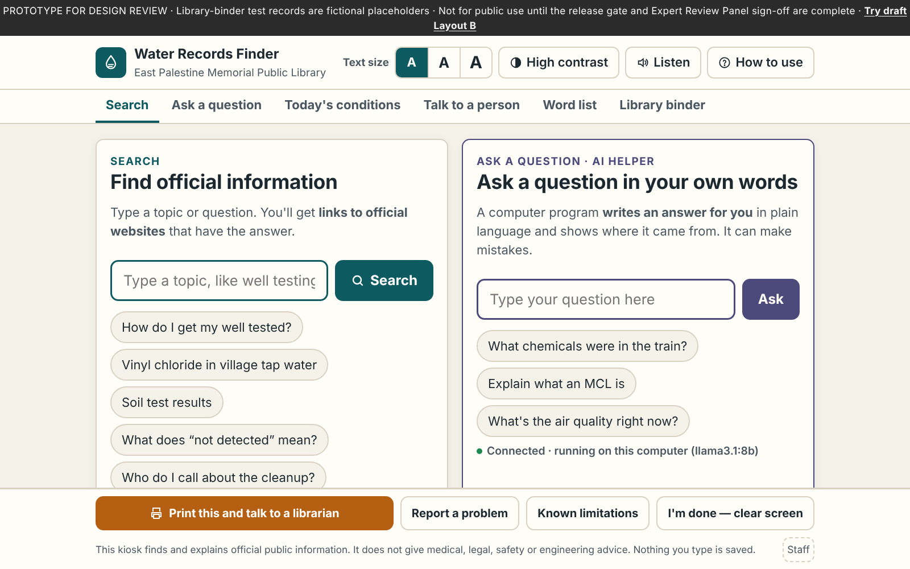
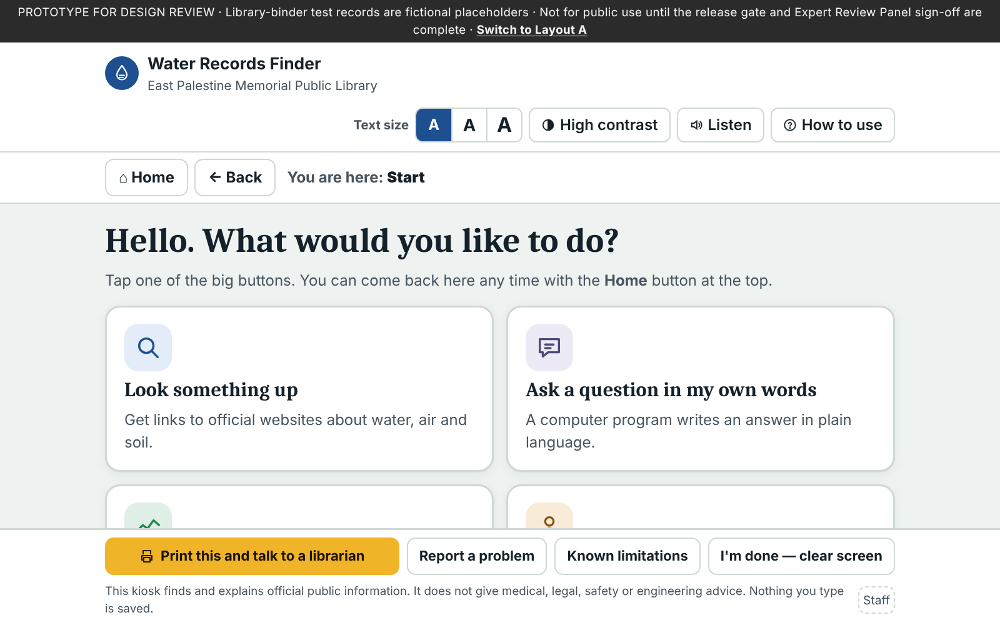
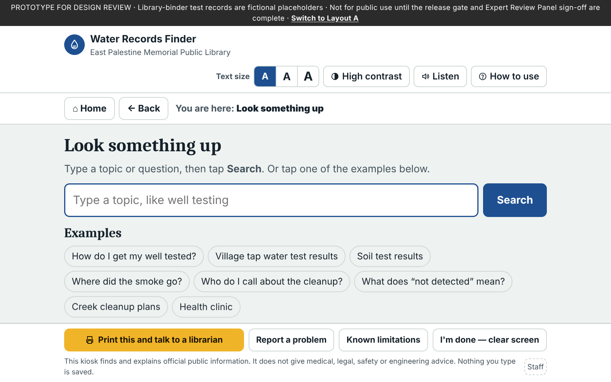
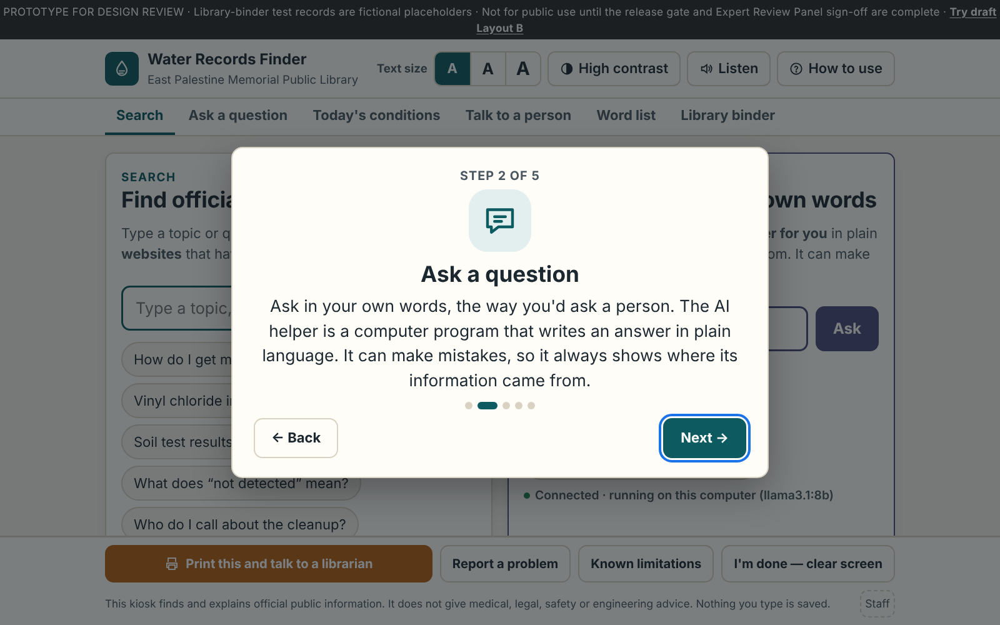
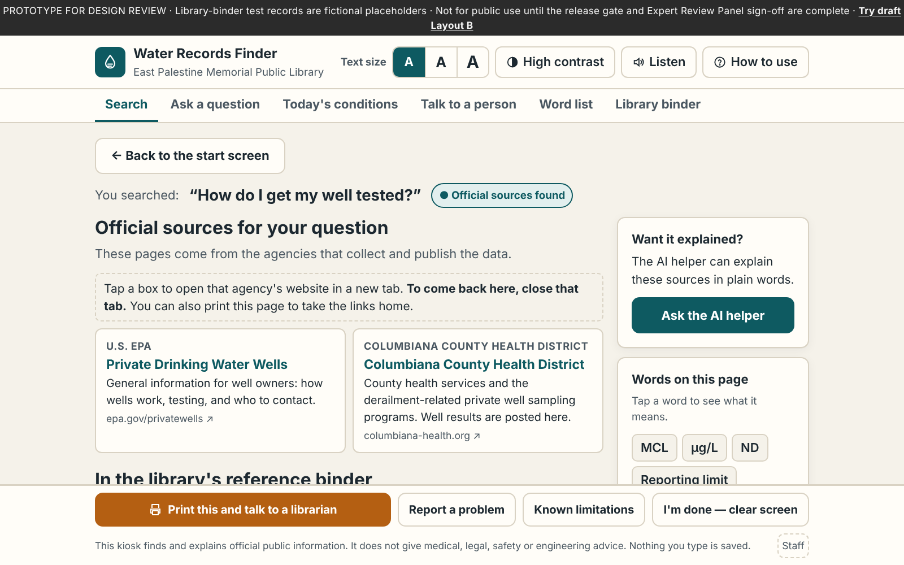
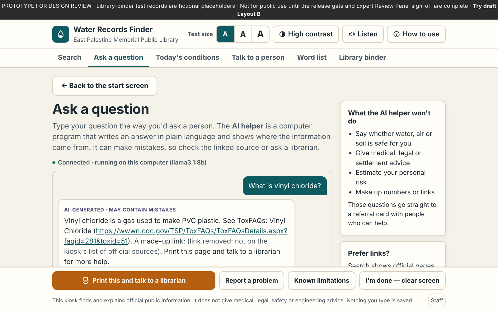
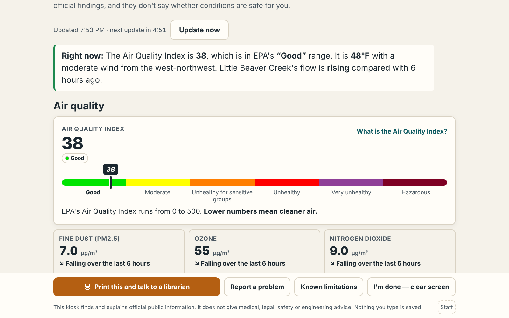
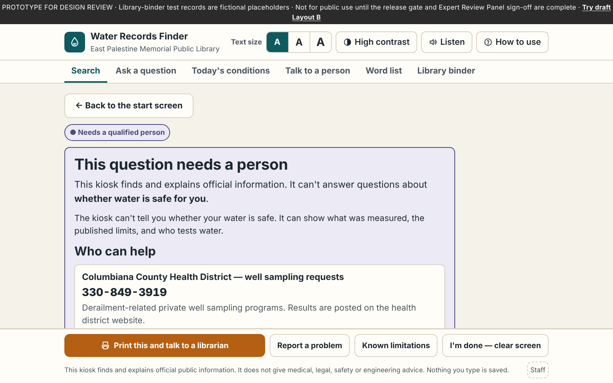

# Water Records Finder

A front-end prototype of the touchscreen kiosk planned for the **East Palestine Memorial Public Library** in East Palestine, Ohio. The kiosk helps local residents find, read and understand official water, air and soil information published after the February 2023 train derailment.

It is part of **IEEE Tech4Good 2026, Project 26-T4G-227: GenAI-Powered Environmental Health Literacy** (Ohio University, School of EECS).

> **Prototype for design review.** The sample test records in the library-binder section are **fictional placeholders**. Official links, contact numbers and live readings are real. Nothing here should be shown to the public until the release gate in the project requirements is met and the Expert Review Panel has signed off.



## Two layouts to compare

| | **Layout A** (`index.html`) | **Draft Layout B** (`draft-b/index.html`) |
|---|---|---|
| Idea | Everything on one start screen: both search boxes, today's conditions and topic tiles | One big choice at a time: *Look something up*, *Ask a question*, *Check today's conditions*, *Talk to a person* |
| Navigation | Tabs across the top | **Home** and **Back** buttons with a "You are here" label |
| Look | Teal and amber, sans-serif | Lake blue and sunflower, serif headings, larger default text (24 px) |
| Live web version | [gurmehar-chima.github.io/east-palestine-water-records-finder](https://gurmehar-chima.github.io/east-palestine-water-records-finder/) | […/draft-b/](https://gurmehar-chima.github.io/east-palestine-water-records-finder/draft-b/) |

Both layouts run the same code, so the safety rules, search, AI helper and live data behave identically. Layout B is `index.html` with `data-layout="guided"` on the `<html>` tag. A link in the grey strip at the top of each page switches to the other layout.

| Layout B start screen | Layout B search |
|---|---|
|  |  |

## Designed for first-time and older visitors

We reviewed every screen as a 70-year-old first-time visitor would and changed what was confusing:

| What was confusing | What changed |
|---|---|
| Two search boxes with no guidance | A "Not sure which to use?" line explains them: Search gives links, Ask a question writes an answer. "AI helper" is described as "a computer program that writes an answer." |
| No instructions anywhere | A **How to use** button opens a five-step illustrated tour. The welcome screen offers "Show me how it works." |
| Bare numbers like "AQI 38" or "310 ft³/s" | A one-sentence summary in everyday words ("The Air Quality Index is 38, which is in EPA's 'Good' range…"), an AQI color scale with a marker, trend words (rising, falling, steady), and a **What is this?** button on every reading |
| Small chart labels and two-letter day names | Bigger axis text, full day names, thicker lines, and plain captions ("Lower is cleaner") |
| The screen cleared after 3 minutes with no warning | 5 minutes, with an "Are you still there?" warning and a 30-second countdown. Any touch keeps the session. |
| Unlabeled "A A A" buttons; "Read aloud"; "End session" | "Text size" label; **Listen**; **I'm done — clear screen** |
| The only way to reach a person was the print button | A **Talk to a person** page with the reference desk and local phone numbers, reachable from every screen |
| Links opened new tabs with no explanation | A note on every results page: "To come back here, close that tab." |
| Long pages with Back only at the top | Back and **Back to top** buttons at the bottom of every page |
| Cut-off example text in the search box | Shorter placeholder text |
| Base text 20 px | Base text 22 px (24 px in Layout B), with two larger sizes |



### Animations

Gentle motion helps people notice what changed. Every animation is switched off automatically when the device's "Reduce motion" setting is on.

- Pages and cards rise into place one after another.
- Live numbers count up, chart lines draw in, and the AQI marker slides to its spot on the scale.
- A pulsing green dot shows that today's conditions are live.
- Loading readings show a soft shimmer instead of blank boxes.
- Chat answers and dialogs ease in, and the help tour slides between steps.
- The idle warning shows a ring that empties as the 30 seconds count down.

## What it does

The home screen has **two search bars**:

| | **Search** | **Ask a question (AI helper)** |
|---|---|---|
| What you type | Any question or topic, in any wording | Any question, in your own words |
| What you get | Links to the official pages that have the answer (U.S. EPA, Ohio EPA, Columbiana County Health District, ATSDR, NIEHS, USGS and others), plus matching library-binder records and word-list definitions | A plain-language explanation written by an AI model that runs on the device, with links to the sources it was given |
| Uses AI? | No | Yes: Ollama on the kiosk, or a model that runs inside the browser |

A third section, **Today's conditions**, shows air quality, weather and stream flow for East Palestine and updates every 5 minutes.

| Search results | AI helper | Live conditions |
|---|---|---|
|  |  |  |

*Screenshots use simulated live readings and a simulated AI answer.*

### Safety rules (both search bars)

Every question passes through a fixed, rule-based safety check **before** anything is looked up or sent to the AI:

| Result | What happens | Example |
|---|---|---|
| **Found in official records** | Official links, plain-language summary, cited records | "How do I get my well tested?" |
| **Librarian help recommended** | Questions about what results mean or how they compare. Links plus a printable Reference Sheet for library staff | "Is the toluene at the stream high?" |
| **Needs a qualified person** | Never reaches search or the AI. A referral card lists real contacts and official pages | "Is my water safe to drink?" |

The AI helper adds three more protections:

1. Its instructions limit it to the official sources, word list and live readings it is given. It is told never to give safety verdicts, medical, legal or property advice, risk estimates, or claims about causes.
2. Its answer is checked as it streams. If it starts to say something is "safe," "unsafe" or similar, the answer is stopped and replaced with a referral card.
3. Any web link that isn't on the kiosk's list of official sources is removed from the answer.



## Running it

`index.html` is a single self-contained file. Search, the word list and documents work by opening it in any modern browser. The AI helper and live conditions need the steps below.

### AI helper

The AI helper uses the first option that works on the device. No setup is needed for option 2.

| | Where it runs | Setup | When it's used |
|---|---|---|---|
| **1. Ollama** | The kiosk computer | Install Ollama and a model (below) | Whenever Ollama is reachable. This is the kiosk configuration. |
| **2. In-browser AI** | Inside the visitor's browser ([WebLLM](https://github.com/mlc-ai/web-llm) on WebGPU) | None. The visitor taps **Download and turn on** once. | On the GitHub Pages site, in Chrome, Edge or Safari 26+ |
| **3. Claude** | Anthropic's servers | None | Only on the claude.ai preview link, which can't reach Ollama or run WebLLM |

All three go through the same safety check, rules, verdict filter and link filter.

**In-browser AI details.** The model is Llama 3.2 3B on computers and Llama 3.2 1B on phones and tablets. It uses the half-precision build when the graphics chip supports it, and the full-precision build otherwise. The first download is about 2 GB on computers and 0.9 GB on phones. After that it loads from the browser's storage. Questions never leave the device. Answers are slower and simpler than a larger Ollama model.

**Ollama setup (kiosk).**

1. Install Ollama from [ollama.com](https://ollama.com) and download a model:
   ```bash
   ollama pull llama3.1:8b
   ```
2. Serve the page from the kiosk computer itself, so Ollama accepts its requests (Ollama allows `127.0.0.1` by default):
   ```bash
   python3 -m http.server 8080 --bind 127.0.0.1
   ```
   Then open **http://127.0.0.1:8080**.
3. The AI panel shows **Connected · running on this computer**. Staff can change the Ollama address or model under **Staff → AI helper**.

To let the GitHub Pages site use Ollama instead of the in-browser model, allow its address with `OLLAMA_ORIGINS="https://gurmehar-chima.github.io"` and restart Ollama.

### Live conditions

The page reads three public sources directly from the browser. No sign-up or key is needed, and only the village's coordinates are sent.

| Section | Source | What it is | What it isn't |
|---|---|---|---|
| Air quality | [Open-Meteo Air Quality API](https://open-meteo.com/en/docs/air-quality-api) (Copernicus CAMS) | US AQI, PM2.5, ozone and nitrogen dioxide, hourly | A computer-model estimate for a ~25-mile area, not a monitor in East Palestine. It doesn't measure derailment chemicals. |
| Weather | [Open-Meteo Forecast API](https://open-meteo.com/) | Temperature, wind speed and direction, humidity, precipitation | — |
| Stream | [USGS gauge 03109500](https://waterdata.usgs.gov/monitoring-location/USGS-03109500/), Little Beaver Creek near East Liverpool | Stream flow and water level every 15 minutes | Chemical water quality. No live chemical monitor is published for East Palestine. |

**Green, yellow and red lights.** Air quality, fine dust and creek flow each show a colored light:

| Reading | Green | Yellow | Red | Based on |
|---|---|---|---|---|
| Air Quality Index | 0–50 "Good" | 51–100 "Moderate" | 101+ | EPA AQI categories (the full six-color scale is shown) |
| Fine dust (PM2.5), 24-hour average | 0–9.0 µg/m³ "Good" | 9.1–35.4 "Moderate" | 35.5+ "Unhealthy for sensitive groups" or worse | [EPA's 2024 PM2.5 AQI breakpoints](https://www.epa.gov/system/files/documents/2024-02/pm-naaqs-air-quality-index-fact-sheet.pdf) |
| Little Beaver Creek flow | 25th–75th percentile "Normal for this date" | 10th–25th or 75th–90th "Below/Above normal" | Below 10th or above 90th "Much below/above normal" | [USGS daily percentiles](https://help.waterdata.usgs.gov/faq/surface-water/what-is-a-percentile) for today's date (USGS statistics service) |

EPA defines the PM2.5 ranges for 24-hour averages, so the fine-dust light uses the average of the last 24 hourly estimates. Creek flow is not a health measure, and no flood stage is published for this gauge, so its light shows how unusual the flow is for the date. If the USGS statistics can't be loaded, the creek light turns gray instead of guessing.

U.S. EPA's own East Palestine air monitoring page is marked "no longer updated," so it is listed as a search link rather than used as live data. For official monitor AQI, the page links to [AirNow](https://www.airnow.gov/).

USGS plans to retire its legacy WaterServices API in winter 2027. The page already falls back to the newer [USGS Water Data API](https://api.waterdata.usgs.gov/docs/ogcapi/migration).

**Kiosk network allow-list:** `air-quality-api.open-meteo.com`, `api.open-meteo.com`, `waterservices.usgs.gov` (live readings and daily statistics), `api.waterdata.usgs.gov`. The in-browser AI also needs `cdn.jsdelivr.net`, `huggingface.co` and `raw.githubusercontent.com` for its one-time download. Linked agency websites also need to be allowed if patrons should open them on the kiosk.

**Staff controls:** tap **Staff** in the bottom-right corner. On the installed kiosk these would be physical controls, such as a key switch and an emergency button.

## Editing

Edit only `index.html`, then run `node tools/build.js` to regenerate `draft-b/index.html` (and the claude.ai preview files in `dist/`). Commit both `index.html` and `draft-b/index.html`.

## Testing

`tests/smoke-test.js` runs 35 checks offline. `tests/mocks.js` simulates Open-Meteo, USGS, Ollama and the in-browser AI so no network or GPU is needed. The test checks:

- question routing for all three result types
- that any wording returns at least one official link
- that safety questions never reach the AI
- that unofficial links are stripped from AI answers
- that AI answers containing a safety verdict are withheld
- that the live charts draw, and that the green/yellow/red lights switch at the right numbers
- that the in-browser AI can be turned on and answers a question that was waiting
- that the idle warning appears and a touch keeps the session, and that the help tour opens
- that Layout B's big choices, search and Back button work

```bash
npm install playwright
npx playwright install chromium
node tests/smoke-test.js
```

When adding red-team questions (the project calls for 75), add them to `ROUTING` with the result they must produce.

## Repository layout

```
index.html               The complete kiosk page, Layout A (HTML, CSS and JavaScript in one file)
draft-b/index.html       Layout B, generated from index.html by tools/build.js (don't edit by hand)
tools/build.js           Builds draft-b/ and the claude.ai preview files in dist/ (not committed)
link.md                  Link to the claude.ai preview of the page
tests/smoke-test.js      Routing, search, AI-safety and live-chart tests
tests/mocks.js           Simulated Open-Meteo, USGS, Ollama and WebLLM responses for the tests
docs/screenshots/        Screenshots used in this README
```

Inside `index.html`, the script is organized in numbered sections:

| Section | Contents | What to change there |
|---|---|---|
| 1 | Demo corpus: `DOCS`, `LOCATIONS`, `ANALYTES`, `RECORDS`, `GLOSSARY` | Replace with the ingestion pipeline's output |
| 2–3 | State (memory only) and utilities | — |
| 4 | Safety check (`TIER3` rules, `TIER2` pattern) and record retrieval | — |
| 5–7 | Router and record views | — |
| 7b | `RESOURCES`: the official links that search and the AI draw on | Add or retire links here |
| 7b | `CONTACTS`: the phone numbers on referral cards | Re-confirm regularly |
| 7c | Search results | — |
| 7d | AI helper: `AI_RULES` (the model's instructions), the output filter, Ollama and in-browser (WebLLM) streaming | — |
| 7e | Live conditions: data loaders, refresh timer and SVG charts | — |
| 7f | Easier reading: plain-language summaries, trends, AQI scale, help tour, idle warning, Talk to a person | Tour text lives in `TOUR` |
| 7g | Layout B: big-choice start screen, search screen and Back navigation | — |
| 8–13 | Banners, modals, printing, read-aloud, session reset and events | — |

## Requirements covered

The IDs refer to the project's student requirements document.

- **FR-2, FR-12:** library-binder answers appear only when a record matches, and the page says plainly when there is no data. Search always offers official links.
- **FR-3, FR-4:** every binder result shows its source, agency, dates and shelf location. Results without a citation are not displayed.
- **FR-5 to FR-8:** the safety check runs before search and before any AI call.
- **FR-9:** health-effects text only appears in slots for approved ATSDR/IRIS fact cards, shown word for word. The prototype contains none, and the AI is told not to describe health effects beyond the sources it's given.
- **FR-10, FR-13, FR-15:** "Print this and talk to a librarian," "Known limitations" and "Report a problem" are on every screen.
- **FR-11:** when two sources disagree, both are shown and flagged for a librarian.
- **FR-14:** a disclaimer screen must be accepted before first use, and every printout carries the disclaimer.
- **FR-16, FR-17, FR-22:** the kill switch, emergency mode and "reference desk staffed" toggle also pause the AI helper.
- **FR-18, FR-19:** stale documents are flagged, and the 180-day auto-sunset turns off questions.
- **FR-21, NFR-1, NFR-2:** only anonymous counts are kept, in memory. Ollama and the in-browser AI both keep questions on the device, and the session clears after 3 minutes idle.
- **NFR-7, NFR-9:** plain-language summaries, a word list, three text sizes, high contrast, read-aloud, large touch targets, and keyboard-readable charts with a "Show the numbers" table.

## Known gaps before real use

- **Release-gate testing.** The safety check is keyword-based. It must reach 100% correct refusal on the 75-item red-team set, and the AI must be evaluated on the 200-question benchmark, before release.
- **AI instead of retrieval.** The requirements describe the kiosk as a retrieval index with templated answers. The AI helper writes its own explanations, so it needs Expert Review Panel approval as a content class, or it should stay switched off.
- **Demo records.** The library-binder records are fictional and must be replaced by the ingestion pipeline.
- **Contacts and links.** Phone numbers come from U.S. EPA's East Palestine pages (checked November 2026). Two of those pages are marked "no longer updated," so staff should confirm the numbers regularly.
- **Approvals.** The word list, "Known limitations" text and fact cards need Expert Review Panel approval.

## License

Per the project requirements, code will be released under **Apache-2.0** and content under **CC-BY-4.0**. A license file will be added once the project lead approves the release.

## Disclaimer

This prototype is not medical, legal or environmental engineering advice. It is not affiliated with or endorsed by U.S. EPA, Ohio EPA or Norfolk Southern. Neither IEEE nor Ohio University warrants the accuracy of agency data. IEEE's role is funding and dissemination only. Live readings are automated and unverified.
