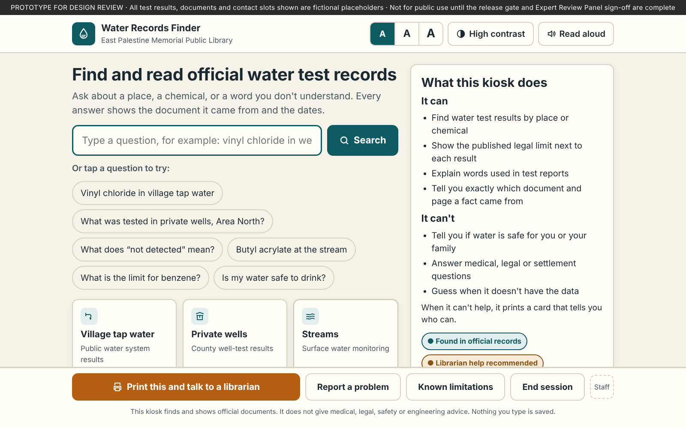
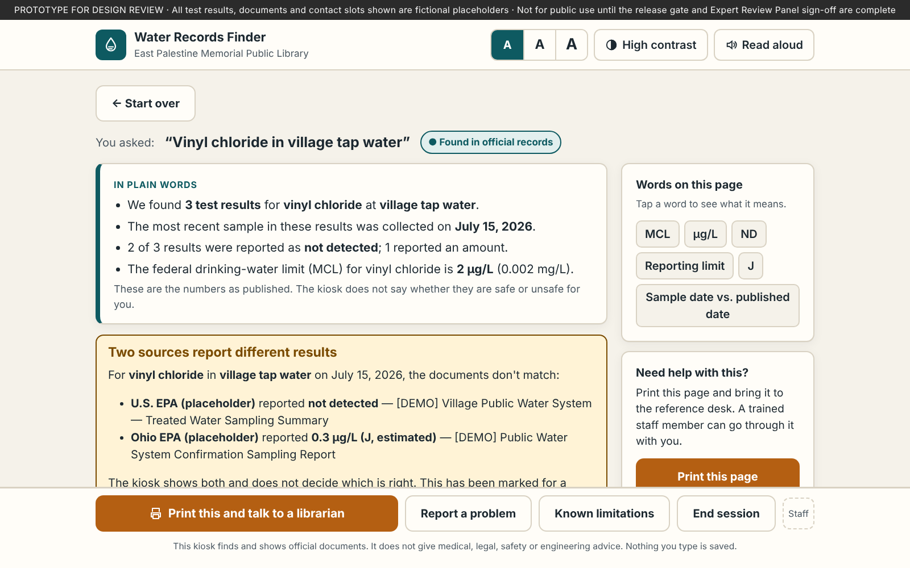
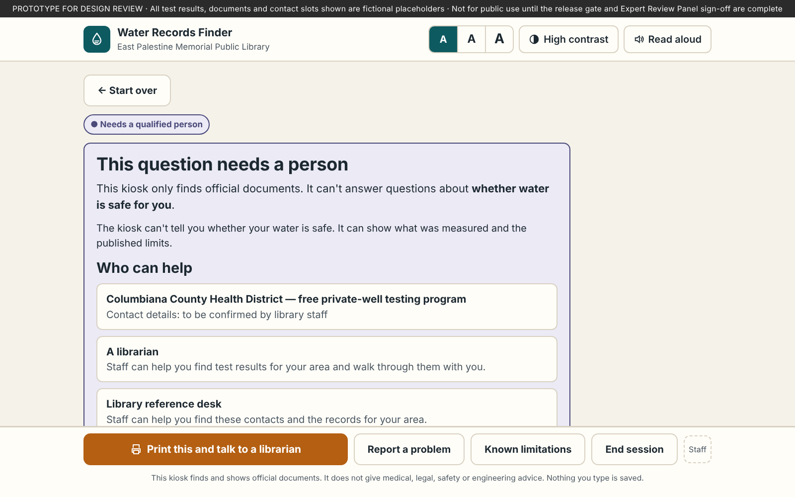

# Water Records Finder

A front-end prototype of the touchscreen kiosk planned for the **East Palestine Memorial Public Library** in East Palestine, Ohio. The kiosk helps local residents find, read and understand official water quality and health monitoring documents published after the February 2023 train derailment.

It is part of **IEEE Tech4Good 2026, Project 26-T4G-227: GenAI-Powered Environmental Health Literacy** (Ohio University, School of EECS).

> **Prototype for design review.** All sampling results, document titles and contact slots in this page are **fictional placeholders**. Nothing here should be shown to the public until the release gate in the project requirements is met and the Expert Review Panel has signed off.



## What it does

The kiosk works as a **retrieval index, not an advisor**. It only answers from a closed set of official documents. It shows the source and dates for every fact and summarizes results in plain language (6th–8th grade reading level). Any question about health, safety or legal matters goes to a qualified person.

Every question passes through a fixed rule-based safety check **before** anything is looked up:

| Tier | What happens | Example |
|---|---|---|
| **1 · Found in official records** | Shows a plain-language summary, each lab result next to the published federal limit (MCL), a date banner and a full citation | "Vinyl chloride in village tap water" |
| **2 · Librarian help recommended** | Questions about what results mean or how they compare produce a printable Reference Sheet for trained library staff to go through with the patron | "Is the toluene at the stream high?" |
| **3 · Needs a qualified person** | Refused before any lookup and replaced by a printed referral card with who to contact | "Is my water safe to drink?" |
| **No match** | Says so plainly, never guesses, and prints a referral slip | "What's the weather?" |

| Answer with citations | Referral card |
|---|---|
|  |  |

### Requirements covered by the prototype

The IDs refer to the project's student requirements document.

- **FR-2, FR-12:** answers only when a record matches. Says "We don't have data on that" when nothing does.
- **FR-3, FR-4:** every result shows the source title, agency, publication date and shelf location or link, plus the line "Source published · Sample collected · Corpus updated." A result with no citation is not displayed.
- **FR-5 to FR-8:** the safety check runs first and covers individual safety verdicts, medical questions, personal risk or dose, causation, legal or settlement questions, property or insurance, and attempts to change the kiosk's instructions.
- **FR-9:** health-effects text only appears in slots for approved ATSDR/IRIS fact cards shown word for word. The prototype contains none.
- **FR-10, FR-13, FR-15:** "Print this and talk to a librarian," "Known limitations" and "Report a problem" are on every screen.
- **FR-11:** when two sources disagree, both are shown with their sources and flagged for a librarian.
- **FR-14:** a disclaimer screen must be accepted before first use, and every printout carries the disclaimer.
- **FR-16, FR-17, FR-22:** staff controls include the kill switch, emergency mode and a "reference desk staffed" toggle.
- **FR-18, FR-19:** documents more than 90 days past their expected update show a "may be out of date" banner. After 180 days without a signed refresh, questions shut off and only the document browser stays available.
- **FR-21, NFR-1, NFR-2:** keeps only anonymous counts in memory, uses no cookies or storage, makes no network requests, and resets after 3 minutes idle.
- **NFR-7, NFR-9:** plain-language summaries, a word list, tappable column headings, three text sizes, high-contrast mode, read-aloud and large touch targets.

## Running it

It is a single self-contained file with no build step and no dependencies.

1. Download or clone this repository.
2. Open `index.html` in any modern browser.

On the kiosk, run it full screen (for example, Chromium's `--kiosk` mode). The page is designed for the 24-inch 1920×1080 touchscreen and also works on phones.

**Staff controls:** tap **Staff** in the bottom-right corner. On the installed kiosk these would be physical controls, such as a key switch and an emergency button.

## Testing

`tests/smoke-test.js` checks that 16 sample questions route to the correct tier and that the page loads without errors.

```bash
npm install playwright
npx playwright install chromium
node tests/smoke-test.js
```

When adding red-team questions (the project calls for 75), add them to the `CASES` list with the tier they must produce.

## Repository layout

```
index.html               The complete kiosk page (HTML, CSS and JavaScript in one file)
tests/smoke-test.js      Routing and load test
docs/screenshots/        Screenshots used in this README
```

Inside `index.html`, the script is organized in numbered sections:

1. **Demo corpus:** `DOCS`, `LOCATIONS`, `ANALYTES`, `RECORDS` and `GLOSSARY`. Replace these with the output of the ingestion pipeline.
2. **State:** kept in memory only.
3. **Utilities.**
4. **Safety check and retrieval:** `TIER3` rules, the `TIER2` pattern and `retrieve()`.
5. **Router:** `ask()`.
6. through 13. **Rendering, modals, printing, read-aloud, session reset and events.**

## Before real use

- **Replace the demo corpus.** The production design calls for a local retrieval pipeline (llama.cpp or Ollama, a sentence-embedding model, and Chroma or FAISS). Keyword matching in `retrieve()` stands in for that. The safety check and the routing are the parts meant to carry over.
- **Verify the federal limits.** MCL values in `ANALYTES` are standard reference values but must be checked against the ingested copy of the U.S. EPA National Primary Drinking Water Regulations.
- **Fill in contacts.** Referral cards show "to be confirmed by library staff" where phone numbers and addresses belong. The only real numbers included are 911 and Poison Help (1-800-222-1222).
- **Get approvals.** The word list, "Known limitations" text and fact cards need written Expert Review Panel approval.
- **Test the safety check.** It uses keyword rules and must reach 100% correct refusal on the 75-item red-team set before release.

## License

Per the project requirements, code will be released under **Apache-2.0** and content under **CC-BY-4.0**. A license file will be added once the project lead approves the release.

## Disclaimer

This prototype is not medical, legal or environmental engineering advice. It is not affiliated with or endorsed by U.S. EPA, Ohio EPA or Norfolk Southern. Neither IEEE nor Ohio University warrants the accuracy of agency data. IEEE's role is funding and dissemination only.
