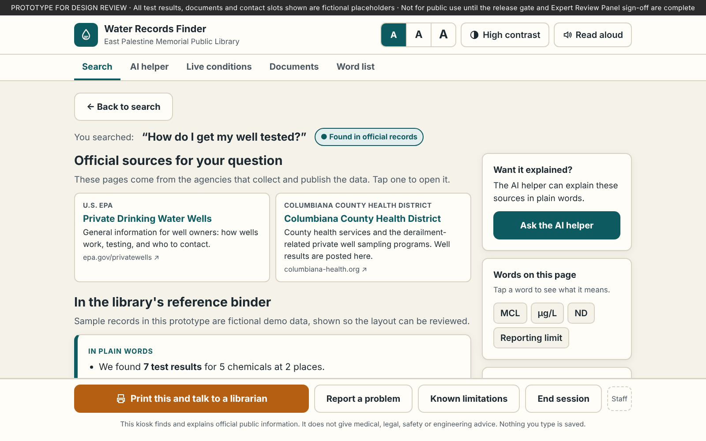
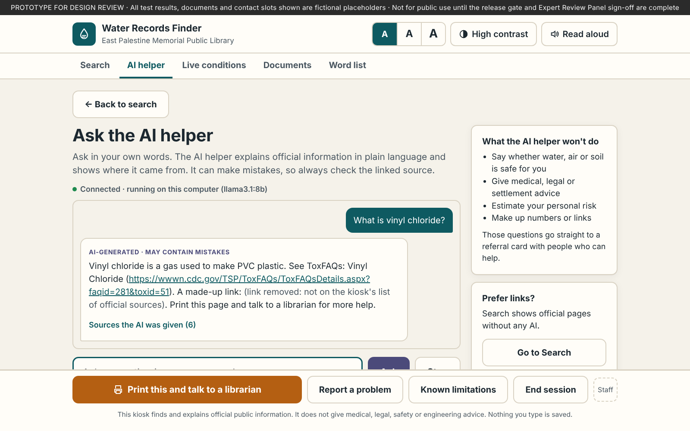
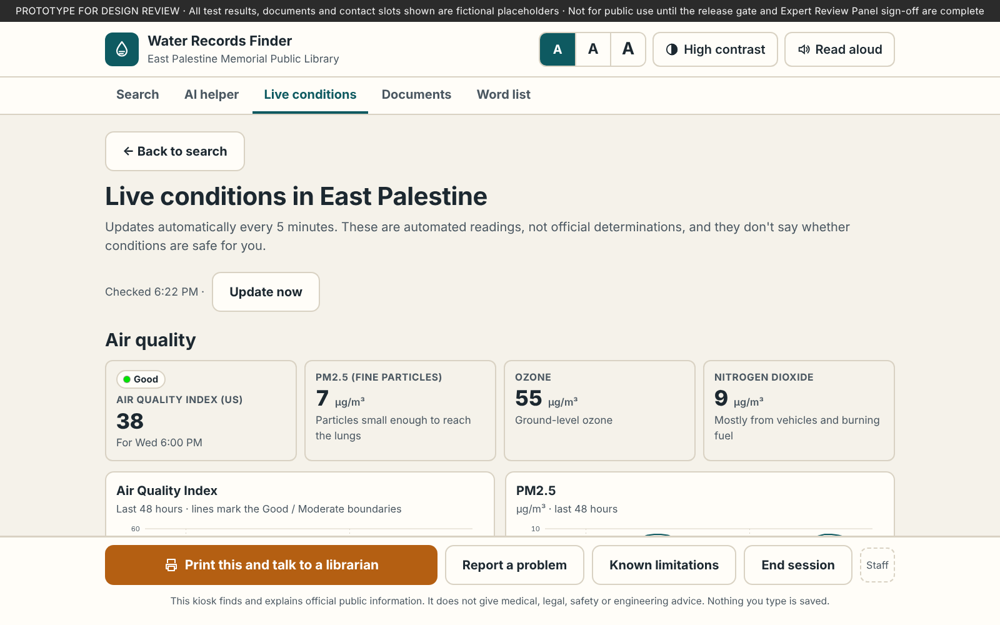

# Water Records Finder

A front-end prototype of the touchscreen kiosk planned for the **East Palestine Memorial Public Library** in East Palestine, Ohio. The kiosk helps local residents find, read and understand official water, air and soil information published after the February 2023 train derailment.

It is part of **IEEE Tech4Good 2026, Project 26-T4G-227: GenAI-Powered Environmental Health Literacy** (Ohio University, School of EECS).

> **Prototype for design review.** The sample test records in the library-binder section are **fictional placeholders**. Official links, contact numbers and live readings are real. Nothing here should be shown to the public until the release gate in the project requirements is met and the Expert Review Panel has signed off.


## What it does

The home screen has **two search bars**:

| | **Search** | **AI helper** |
|---|---|---|
| What you type | Any question or topic, in any wording | Any question, in your own words |
| What you get | Links to the official pages that have the answer (U.S. EPA, Ohio EPA, Columbiana County Health District, ATSDR, NIEHS, USGS and others), plus matching library-binder records and word-list definitions | A plain-language explanation written by a local AI model (Ollama), with links to the sources it was given |
| Uses AI? | No | Yes, running on the kiosk computer |

A third section, **Live conditions**, shows air quality, weather and stream flow for East Palestine and updates every 5 minutes.

| Search results | AI helper | Live conditions |
|---|---|---|
|  |  |  |

*Screenshots use simulated live readings and a simulated AI answer.*

### Safety rules (both search bars)

Every question passes through a fixed, rule-based safety check **before** anything is looked up or sent to the AI:

| Result | What happens | Example |
|---|---|---|
| **Found in official records** | Official links, plain-language summary, cited records | "How do I get my well tested?" |
| **Librarian help recommended** | Questions about what results mean or how they compare. Links plus a printable Reference Sheet for library staff | "Is the toluene at the stream high?" |
| **Needs a qualified person** | Never reaches search or the AI. A referral card lists real contacts and official pages | "Is my water safe to drink?" |

The AI helper adds three more protections:

1. Its instructions limit it to the official sources, word list and live readings it is given. It is told never to give safety verdicts, medical, legal or property advice, risk estimates, or claims about causes.
2. Its answer is checked as it streams. If it starts to say something is "safe," "unsafe" or similar, the answer is stopped and replaced with a referral card.
3. Any web link that isn't on the kiosk's list of official sources is removed from the answer.


## Running it

`index.html` is a single self-contained file. Search, the word list and documents work by opening it in any modern browser. The AI helper and live conditions need the steps below.

### AI helper (Ollama)

1. Install Ollama from [ollama.com](https://ollama.com) and download a model:
   ```bash
   ollama pull llama3.1:8b
   ```
   Any chat model works. A Llama- or Qwen-class 7–8B model fits the kiosk's 16 GB GPU.
2. Serve the page from the kiosk computer itself, so Ollama accepts its requests (Ollama allows `127.0.0.1` by default):
   ```bash
   python3 -m http.server 8080 --bind 127.0.0.1
   ```
   Then open **http://127.0.0.1:8080**.
3. The AI panel shows **Connected** when it finds Ollama. Staff can change the Ollama address or model under **Staff → AI helper**.

To use the AI helper from a different web address (for example a GitHub Pages copy), allow that address in Ollama with `OLLAMA_ORIGINS`, then restart Ollama:

```bash
# macOS
launchctl setenv OLLAMA_ORIGINS "https://gurmehar-chima.github.io"
# Linux (systemd): add  Environment="OLLAMA_ORIGINS=https://gurmehar-chima.github.io"  with  systemctl edit ollama.service
# Windows: add OLLAMA_ORIGINS as a user environment variable
```

**On the claude.ai preview link** ([link.md](link.md)), the page can't reach Ollama. There the AI helper uses Claude instead and says so on screen. The same safety check, rules and filters apply.

### Live conditions

The page reads three public sources directly from the browser. No sign-up or key is needed, and only the village's coordinates are sent.

| Section | Source | What it is | What it isn't |
|---|---|---|---|
| Air quality | [Open-Meteo Air Quality API](https://open-meteo.com/en/docs/air-quality-api) (Copernicus CAMS) | US AQI, PM2.5, ozone and nitrogen dioxide, hourly | A computer-model estimate for a ~25-mile area, not a monitor in East Palestine. It doesn't measure derailment chemicals. |
| Weather | [Open-Meteo Forecast API](https://open-meteo.com/) | Temperature, wind speed and direction, humidity, precipitation | — |
| Stream | [USGS gauge 03109500](https://waterdata.usgs.gov/monitoring-location/USGS-03109500/), Little Beaver Creek near East Liverpool | Stream flow and water level every 15 minutes | Chemical water quality. No live chemical monitor is published for East Palestine. |

U.S. EPA's own East Palestine air monitoring page is marked "no longer updated," so it is listed as a search link rather than used as live data. For official monitor AQI, the page links to [AirNow](https://www.airnow.gov/).

USGS plans to retire its legacy WaterServices API in winter 2027. The page already falls back to the newer [USGS Water Data API](https://api.waterdata.usgs.gov/docs/ogcapi/migration).

**Kiosk network allow-list:** `air-quality-api.open-meteo.com`, `api.open-meteo.com`, `waterservices.usgs.gov`, `api.waterdata.usgs.gov`. Linked agency websites also need to be allowed if patrons should open them on the kiosk.

**Staff controls:** tap **Staff** in the bottom-right corner. On the installed kiosk these would be physical controls, such as a key switch and an emergency button.

## Testing

`tests/smoke-test.js` runs 28 checks offline. `tests/mocks.js` simulates Open-Meteo, USGS and Ollama so no network or GPU is needed. The test checks:

- question routing for all three result types
- that any wording returns at least one official link
- that safety questions never reach the AI
- that unofficial links are stripped from AI answers
- that AI answers containing a safety verdict are withheld
- that the live charts draw

```bash
npm install playwright
npx playwright install chromium
node tests/smoke-test.js
```

When adding red-team questions (the project calls for 75), add them to `ROUTING` with the result they must produce.

## Repository layout

```
index.html               The complete kiosk page (HTML, CSS and JavaScript in one file)
link.md                  Link to the claude.ai preview of the page
tests/smoke-test.js      Routing, search, AI-safety and live-chart tests
tests/mocks.js           Simulated Open-Meteo, USGS and Ollama responses for the tests
docs/screenshots/        Screenshots used in this README
```

Inside `index.html`, the script is organized in numbered sections:

| Section | Contents | What to change there |
|---|---|---|
| 1 | Demo corpus: `DOCS`, `LOCATIONS`, `ANALYTES`, `RECORDS`, `GLOSSARY` | Replace with the ingestion pipeline's output |
| 2–3 | State (memory only) and utilities | — |
| 4 | Safety check (`TIER3` rules, `TIER2` pattern) and record retrieval | — |
| 5–7 | Router and record views | — |
| 7b | `RESOURCES`: the official links that search and the AI draw on | Add or retire links here |
| 7b | `CONTACTS`: the phone numbers on referral cards | Re-confirm regularly |
| 7c | Search results | — |
| 7d | AI helper: `AI_RULES` (the model's instructions), the output filter and Ollama streaming | — |
| 7e | Live conditions: data loaders, refresh timer and SVG charts | — |
| 8–13 | Banners, modals, printing, read-aloud, session reset and events | — |

## Requirements covered

The IDs refer to the project's student requirements document.

- **FR-2, FR-12:** library-binder answers appear only when a record matches, and the page says plainly when there is no data. Search always offers official links.
- **FR-3, FR-4:** every binder result shows its source, agency, dates and shelf location. Results without a citation are not displayed.
- **FR-5 to FR-8:** the safety check runs before search and before any AI call.
- **FR-9:** health-effects text only appears in slots for approved ATSDR/IRIS fact cards, shown word for word. The prototype contains none, and the AI is told not to describe health effects beyond the sources it's given.
- **FR-10, FR-13, FR-15:** "Print this and talk to a librarian," "Known limitations" and "Report a problem" are on every screen.
- **FR-11:** when two sources disagree, both are shown and flagged for a librarian.
- **FR-14:** a disclaimer screen must be accepted before first use, and every printout carries the disclaimer.
- **FR-16, FR-17, FR-22:** the kill switch, emergency mode and "reference desk staffed" toggle also pause the AI helper.
- **FR-18, FR-19:** stale documents are flagged, and the 180-day auto-sunset turns off questions.
- **FR-21, NFR-1, NFR-2:** only anonymous counts are kept, in memory. Ollama runs on the kiosk, and the session clears after 3 minutes idle.
- **NFR-7, NFR-9:** plain-language summaries, a word list, three text sizes, high contrast, read-aloud, large touch targets, and keyboard-readable charts with a "Show the numbers" table.

## Known gaps before real use

- **Release-gate testing.** The safety check is keyword-based. It must reach 100% correct refusal on the 75-item red-team set, and the AI must be evaluated on the 200-question benchmark, before release.
- **AI instead of retrieval.** The requirements describe the kiosk as a retrieval index with templated answers. The AI helper writes its own explanations, so it needs Expert Review Panel approval as a content class, or it should stay switched off.
- **Demo records.** The library-binder records are fictional and must be replaced by the ingestion pipeline.
- **Contacts and links.** Phone numbers come from U.S. EPA's East Palestine pages (checked November 2026). Two of those pages are marked "no longer updated," so staff should confirm the numbers regularly.
- **Approvals.** The word list, "Known limitations" text and fact cards need Expert Review Panel approval.

## License

Per the project requirements, code will be released under **Apache-2.0** and content under **CC-BY-4.0**. A license file will be added once the project lead approves the release.

## Disclaimer

This prototype is not medical, legal or environmental engineering advice. It is not affiliated with or endorsed by U.S. EPA, Ohio EPA or Norfolk Southern. Neither IEEE nor Ohio University warrants the accuracy of agency data. IEEE's role is funding and dissemination only. Live readings are automated and unverified.
